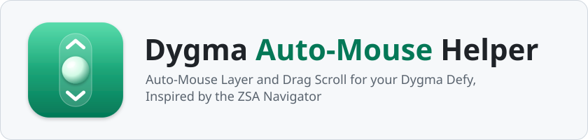
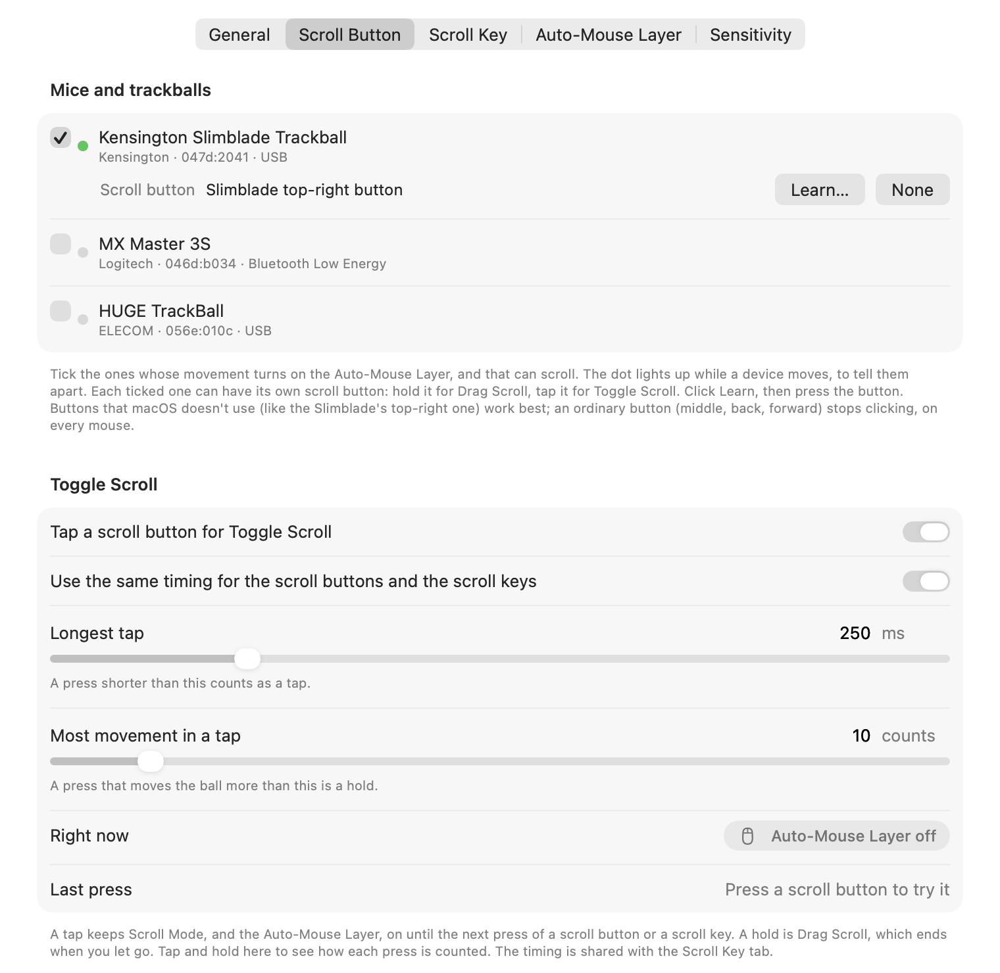
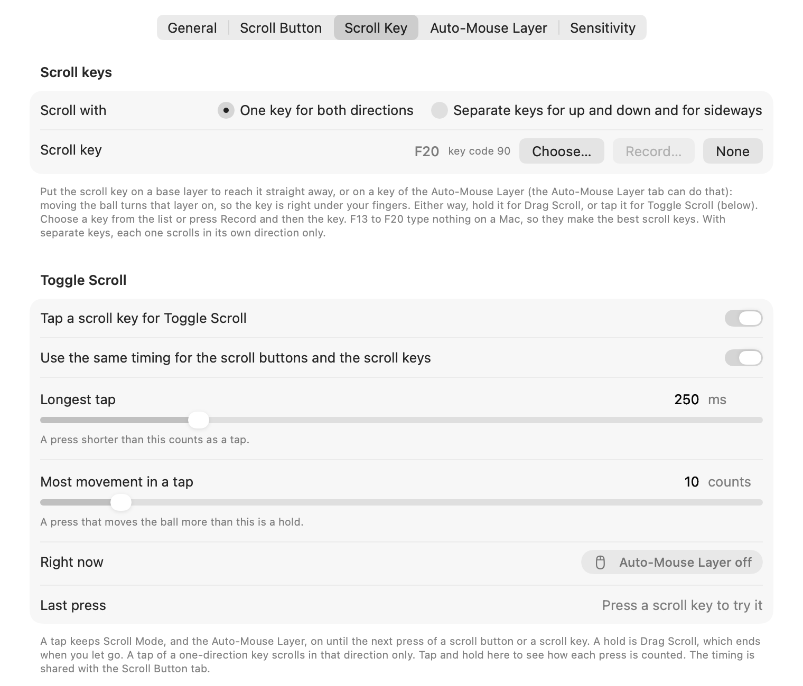
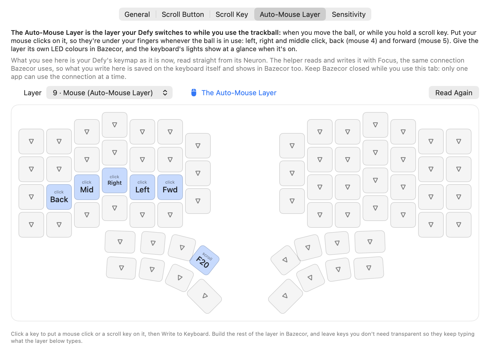
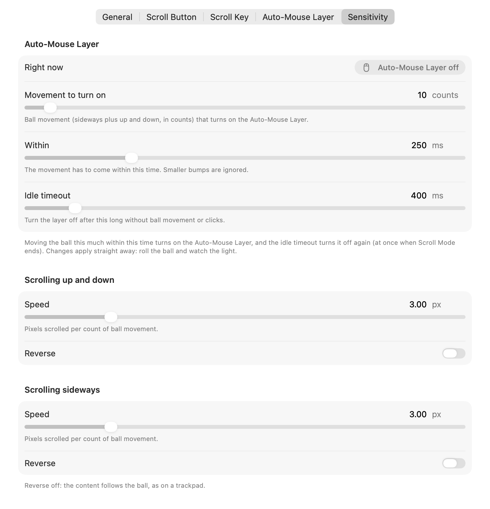
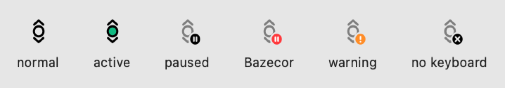

<h1>
  <picture>
    <source media="(prefers-color-scheme: dark)" srcset="docs/banner-dark.svg">
    
  </picture>
</h1>

[](https://github.com/harnoldcodes/dygma-auto-mouse-helper/releases)
[](LICENSE)

A macOS menu bar app that gives the Dygma Defy the ZSA Navigator's **Auto-Mouse Layer** and **Drag Scroll**, with any trackball or mouse. Moving the ball turns on the Defy's Auto-Mouse Layer, so mouse clicks and scroll keys sit under your other hand, and the idle timeout turns it off once the ball rests. Hold a trackball button or a scroll key for **Drag Scroll**, or tap one for **Toggle Scroll**: either way the ball scrolls smoothly in any direction.

## Requirements

- macOS 13 (Ventura) or later, on Apple silicon or Intel.
- A Dygma Defy connected to the Mac by USB: wired, or wireless in RF mode with its Neuron plugged in.
- A trackball or mouse. The default scroll button is the Kensington Slimblade's top-right one.

> [!IMPORTANT]
> The app turns the Auto-Mouse Layer on and off through Dygma's Focus API on the Defy's USB serial port. Over Bluetooth there's no such port, so the layer doesn't switch; Drag Scroll and Toggle Scroll with a trackball button still work.

## Installation

```sh
brew tap harnoldcodes/dygma-auto-mouse-helper https://github.com/harnoldcodes/dygma-auto-mouse-helper
brew trust harnoldcodes/dygma-auto-mouse-helper
brew install --cask dygma-auto-mouse-helper
```

### From source

```sh
git clone https://github.com/harnoldcodes/dygma-auto-mouse-helper.git
cd dygma-auto-mouse-helper
./install.sh             # build, install and open a dev build
./install.sh --release   # put the Homebrew release back
./uninstall.sh           # remove it; --purge also deletes the settings, certificate, log and permissions
```

- Needs Apple's Command Line Tools (`xcode-select --install`).
- A dev build's version names its commit, such as `0.1.0-dev+dcbd184` (`.dirty` with uncommitted changes). The menu and the General tab mark it.
- With the Homebrew release installed, the dev build takes its place in `/Applications`, so there's one copy and your permissions carry over. Otherwise it goes in `~/Applications`.
- It's signed with a certificate made on your Mac the first time, kept in `~/.local/state/dygma-auto-mouse-helper/`, so later builds keep their permissions.

### Permissions

The app asks on its first start, and its window shows what's missing. Under **System Settings › Privacy & Security**, switch on **Dygma Auto-Mouse Helper** in:

- **Input Monitoring**, to read the trackball. The app restarts itself when you switch it on.
- **Accessibility**, for Drag Scroll and Toggle Scroll, to hold the pointer still and to catch the scroll keys.

macOS ties both to the app's certificate, so updates keep them. If they stop working after a reinstall, remove the app from both lists with **−** and switch it on again when it reappears.

## Configuration

Settings live in the app's window (menu bar icon › **Settings…**, tabs ⌘1 to ⌘5) and in `~/.config/dygma-auto-mouse-helper/config.json5`. The two stay in step: a change in either shows up in the other within a moment.

- **Defaults:** the Slimblade's top-right button and F20 are the scroll button and scroll key, and layer 8 (Bazecor's *Layer 9*) is the Auto-Mouse Layer, with a 400 ms idle timeout.
- **The file** is [JSON5](https://json5.org): JSON with comments and trailing commas. [config.example.json5](config.example.json5) lists every setting with its default and what it does. The app rewrites the file in that form, so your own comments aren't kept.
- **Mistakes:** a setting that can't be used keeps its default, and the window says why. A file that isn't valid JSON5 is left alone until it's fixed. To check a file without the app:

  ```sh
  "/Applications/Dygma Auto-Mouse Helper.app/Contents/MacOS/dygma-auto-mouse-helper" --check-config [path]
  ```

- **Other Dygma keyboards** may work with `keyboard.productIds` (the Raise 2 is `[33, 35]`). Only the Defy is tested.

## Quick start

1. Open the app and switch on both permissions.
2. In **Scroll Button**, tick your trackball; its dot lights up while it moves. Click **Learn…** and press the button to use for Drag Scroll and Toggle Scroll. Use one macOS ignores: an ordinary button stops clicking.

   <picture>
     <source media="(prefers-color-scheme: dark)" srcset="docs/screenshots/scroll-button-dark.png">
     
   </picture>

3. In **Scroll Key**, pick the key for Drag Scroll and Toggle Scroll (F20 by default). **Choose…** it from every key, or **Record…** one; F13 to F20 type nothing on a Mac, so they make the best scroll keys. There can be separate keys for up and down and for sideways.

   <picture>
     <source media="(prefers-color-scheme: dark)" srcset="docs/screenshots/scroll-key-dark.png">
     
   </picture>

4. In **Auto-Mouse Layer**, click keys on the drawing to put mouse clicks (left, right, middle, back, forward) and the scroll key on the Auto-Mouse Layer, then **Write to Keyboard**. The whole keymap is backed up first. Keep Bazecor closed: only one app can talk to the keyboard at a time. To Drag Scroll without moving the ball first, put the scroll key on a base layer in Bazecor as well.

   <picture>
     <source media="(prefers-color-scheme: dark)" srcset="docs/screenshots/auto-mouse-layer-dark.png">
     
   </picture>

5. Move the ball. The Defy turns on the Auto-Mouse Layer and the ring in the menu bar icon fills green. Hold the scroll button or the scroll key and roll for Drag Scroll; tap it for Toggle Scroll.
6. If the layer turns on too eagerly or too late, tune it in **Sensitivity**: how much ball movement, and how quickly, turns it on, the idle timeout, and the scroll speed and direction. *Right now* shows the layer going on and off as you roll.

   <picture>
     <source media="(prefers-color-scheme: dark)" srcset="docs/screenshots/sensitivity-dark.png">
     
   </picture>

If you change the scroll key later, every Defy key that sent the old one is changed to match, and the window asks you to **Write to Keyboard** or **Discard**.

## What it does

| Do this | What happens |
|---|---|
| Move the ball | The Defy turns on the **Auto-Mouse Layer** |
| Let the ball rest | The **idle timeout** turns the layer off |
| Hold a scroll button or key, and roll | **Drag Scroll**: Scroll Mode until you let go. The pointer stays put and the ball scrolls |
| Tap a scroll button or key | **Toggle Scroll**: Scroll Mode, and the layer, stay on until the next press |
| Hold a mouse button | The layer stays on, so drags aren't cut short |
| Open Bazecor | The app lets go of the keyboard until Bazecor quits |

### The menu bar icon

<picture>
  <source media="(prefers-color-scheme: dark)" srcset="docs/screenshots/menu-bar-icons-dark.png">
  
</picture>

| Icon | Means |
|---|---|
| normal | Running, with the Auto-Mouse Layer off |
| active | The Auto-Mouse Layer is on |
| paused | Paused from the menu or the pause shortcut |
| Bazecor | Bazecor is open, so the app has let go of the keyboard |
| warning | A permission is missing, or another app has the trackball to itself; the window says which |
| no keyboard | No Defy on USB. It's picked up within a second of plugging it in |

## Troubleshooting

- **The log:** **Show Log** in the menu opens `~/Library/Logs/dygma-auto-mouse-helper.log`. **Detailed log** adds every layer change and button press.
- **The layer doesn't turn on:** the Defy has to be on USB, not Bluetooth, and Bazecor has to be closed. The General tab shows whether the app has the keyboard.
- **Another app has the trackball to itself:** key remappers such as kanata (used by Mantle) and Karabiner-Elements take over every device they're set to remap, and then no other app can read it. Set yours to leave the trackball alone, or quit it. The helper picks the trackball up as soon as it's let go. A remapper that takes only the Defy doesn't get in the way.
- **The pointer doesn't move:** Toggle Scroll is on (the icon stays green). Press a scroll button or key once.
- **Bazecor can't find the keyboard:** the app lets go of it when Bazecor opens. For another app that needs it, add that app's bundle ID to `keyboard.pauseWhileRunning`, or pause the helper.
- **Talking to the keyboard by hand:** `tools/focus.py layer.state` sends a Focus command. Pause the helper first.

## Architecture

- **The trackball** is read directly (IOKit HID), so the app sees movement before macOS turns it into pointer motion, and buttons macOS ignores.
- **The Auto-Mouse Layer** turns on and off with `layer.activate` and `layer.deactivate` over Dygma's Focus API ([command reference](https://github.com/Dygmalab/Bazecor/blob/development/FOCUS_API.md)), on the USB serial port Bazecor also uses. The layer editor uses `keymap.custom`. Bazecor can also send Focus commands over Bluetooth, in HID reports, which it calls experimental; this app doesn't yet.
- **Scroll Mode** detaches the pointer from the ball and sends pixel scroll events with trackpad-style phases, so apps scroll smoothly in both directions at once.
- **The scroll keys** are caught by an event tap, so they never reach apps. Modifier keys can't be scroll keys.
- **Starting at login** uses a login item, or a LaunchAgent if macOS refuses one.

## Testing

```sh
tests/run.sh [focus-dump.json]   # settings and keymap tests
tools/screenshots.sh --check     # the README's screenshots match what the code draws
./install.sh --build-only        # signed app in ./build, nothing installed
```

- `tests/run.sh` checks the settings file and the keymap decoding. Given a Defy's `keymap.custom` and `superkeys.map` as JSON, it also checks that every key on that keyboard decodes.
- `tools/screenshots.sh` redraws the screenshots, light and dark, from a made-up keymap, layer names and devices.

## Releasing

1. Bump the version in `src/Info.plist`, update this README, run `tools/screenshots.sh`, and commit.
2. Tag `vX.Y.Z` and push the tag.
3. Run `tools/release.sh vX.Y.Z [notes.md]`. It builds and signs the app from the tag, publishes the GitHub release and updates the cask. Then commit and push the cask.

`release.sh` refuses a tag whose screenshots aren't what its code draws, or whose README hasn't changed since the last release (`--readme-unchanged` if nothing in it needed to).

## License

MIT; see [LICENSE](LICENSE). Not affiliated with Dygma, Kensington or ZSA.
